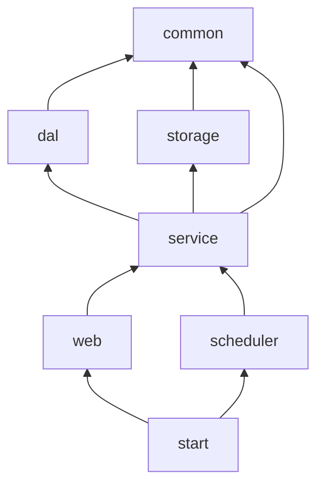

# 后端架构

本文面向后端开发者，说明七个 Maven 模块的职责、依赖方向、事务边界和异步执行方式。采用单一部署进程的原因见[模块化单体 ADR](../decisions/003-modular-monolith.md)。本文不罗列 HTTP 字段或环境变量；这些精确定义分别位于 [API 参考](../reference/API.md) 和[配置参考](../reference/CONFIGURATION.md)。

## 模块依赖



父工程 `backend/pom.xml` 统一管理依赖版本、Java 编译和测试插件。最终可运行制品由 `betterclouddrive-start` 生成。

## 模块职责

| 模块 | 主要内容 | 不应承担 |
|------|----------|----------|
| `betterclouddrive-common` | 通用 DTO、错误码、业务异常、消息 key | 数据库访问、HTTP 或对象存储实现 |
| `betterclouddrive-dal` | JPA Entity、Repository、PostgreSQL 查询 | HTTP 协议和跨存储业务编排 |
| `betterclouddrive-storage` | S3 兼容的对象上传、组合、读取、删除和观测 | 用户/团队权限和文件元数据决策 |
| `betterclouddrive-service` | 业务接口与实现、事务、权限、队列、邮件、任务状态 | Servlet 请求/响应组装 |
| `betterclouddrive-web` | REST Controller、WebDAV、安全过滤器、JWT、异常映射、SSE | 持久化业务规则的唯一实现 |
| `betterclouddrive-scheduler` | 清理、同步、Outbox 发布、后台任务 Worker 和指标刷新 | 新的权威业务状态 |
| `betterclouddrive-start` | Spring Boot 入口、Flyway、Actuator 和最终打包 | 领域逻辑 |

新增代码应沿现有依赖方向放置。下层模块不得反向依赖 `web` 或 `scheduler`；可由不同入口复用的规则应进入 `service`。

## 同步调用路径

```text
HTTP / WebDAV
  -> Security Filter / CurrentUser
  -> Controller
  -> Service interface / implementation
  -> Repository and/or StorageService
  -> PostgreSQL / SeaweedFS / Redis
```

- `web` 将输入转换为 Service 参数并把 `BusinessException` 映射为统一 API 响应。
- `service` 校验资源归属、团队成员身份、细粒度权限、配额和状态转换。
- `dal` 的查询必须显式包含个人/团队、删除状态和父目录等作用域条件。
- `spring.jpa.open-in-view=false`，Controller 不应依赖请求结束前的延迟加载。

## 事务边界

主要写操作在 Service 实现的 `@Transactional` 方法内完成。一个事务可以原子更新多个 PostgreSQL 表，但不能同时原子提交 SeaweedFS、Redis、RabbitMQ 或邮件系统。

跨资源操作采用以下约束降低不一致风险：

- 上传完成前先验证并组合对象，成功后再落文件元数据；完成会话记录保存 `completed_file_id`，允许幂等重试。
- 文件删除、旧版本和过期上传由调度任务做后续清理，不能假设一次请求已经物理移除所有对象。
- 需要可靠异步投递的领域事件先写 PostgreSQL Outbox，再由调度器发布 RabbitMQ。
- 队列消息必须按持久记录 ID 重新读取当前状态，不能把消息正文当作最终事实。
- OnlyOffice 回调以复合唯一键预留，重复回调不会重复创建版本。

修改涉及数据库与对象存储的代码时，应分别考虑“对象成功、数据库失败”和“数据库成功、后续异步工作失败”两种补偿路径。

## 异步处理

`betterclouddrive-scheduler` 包含两类工作：

- 周期维护：回收站、过期分享、上传会话、旧版本、团队清理、分区维护、配额与访问计数同步。
- 持久任务 Worker：团队审计导出、文件夹压缩、缩略图、OnlyOffice 保存、任务结果清理和 Outbox 发布。

RabbitMQ 当前有通知、团队任务和死信相关队列。生产者使用持久消息与 publisher confirm；消费达到最大投递次数后进入死信处理，并在 `dead_letter_records` 中形成可查询、可审计的控制记录。

## 安全边界

- REST 默认使用 Bearer JWT；访问 token 与 refresh token 使用不同密钥和有效期。
- 登出后的 token 标识写入 `user_tokens`，用于撤销检查。
- WebDAV 使用独立开关和独立密码散列，不复用网页登录密码。
- 全局管理员由 `users.role=ROLE_ADMIN` 表示；团队角色是另一个作用域，不能互相替代。
- Controller 的 URL 级限制只是第一层，资源归属和团队文件权限仍由 Service 校验。
- 分享密码以加密密文保存；OnlyOffice 配置和回调使用独立 JWT 密钥。

详细团队权限规则参阅[权限模型](PERMISSIONS.md)。

## 可观测性

请求过滤器生成或继承 request ID 与 W3C trace context；异步记录保存 `traceparent`/`tracestate`，Worker 以 linked trace 继续链路。Actuator 暴露健康、信息和 Prometheus 指标，结构化日志由 Alloy 发送到 Loki。

业务失败应同时满足：返回稳定错误码、留下必要审计或任务状态、避免在日志中暴露密码/token/消息 payload。运行查询和告警入口见[观测与排障](../operations/OBSERVABILITY.md)。

## 变更检查

| 变更 | 同步检查 |
|------|----------|
| Maven 模块依赖 | 本文依赖图、父 POM、受影响模块测试 |
| Entity/Repository | [数据模型](DATA_MODEL.md)、Flyway、集成测试 |
| Controller/DTO/Security matcher | [API 参考](../reference/API.md)、客户端协议测试 |
| 权限计算 | [权限模型](PERMISSIONS.md)、三端 UI 和团队权限测试 |
| Queue/Outbox/Worker | [异步任务流](flows/ASYNC_TASKS.md)、死信与观测手册 |
| 对象路径或生命周期 | [数据模型](DATA_MODEL.md)、上传下载流、备份恢复 |
