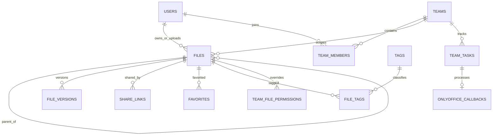

# 数据模型

容量事务计账由 V3 引入：`users/teams.quota_revision` 与业务元数据同事务更新，`quota_accounting_state` 阻止未完成切换的写入，`quota_legacy_transfers` 记录 Redis 旧增量的准确一次应用/确认。V4 增加 `storage_inspection_*` 的运行、引用/对象/容量/任务/层级证据暂存、差异与审核，以及 `storage_quota_repair_previews`、`storage_quota_repairs`。这些是派生诊断数据，源文件及对象保持独立；保留期限与恢复顺序见[存储巡检](../operations/STORAGE_INSPECTIONS.md)。

本文面向后端开发者、数据库维护者和备份设计者，描述核心实体关系、个人/团队作用域和数据生命周期。字段、约束与索引的最终事实来源是 Flyway migration、JPA Entity 和 Repository；本文只解释稳定结构，不复制完整 DDL。

## 存储分工

PostgreSQL 保存业务元数据和状态机；SeaweedFS 保存文件正文、缩略图、历史版本和部分任务结果；Redis 保存可重建的短期状态。数据库中的对象路径不是文件内容本身，备份时必须将 PostgreSQL 与 SeaweedFS 视为一个恢复集合。

## 核心关系

## 表分组

| 领域 | 主要表 | 说明 |
|------|--------|------|
| 身份 | `users`、`user_tokens` | 登录身份、全局角色、状态、配额、WebDAV 与 token 撤销 |
| 团队 | `teams`、`team_members`、`team_invites` | 团队生命周期、成员角色和邀请 |
| 文件 | `files`、`file_versions`、`upload_sessions`、`folder_zip_download_cache` | 文件树、对象路径、版本、断点上传和压缩缓存 |
| 组织 | `favorites`、`tags`、`file_tags` | 收藏与个人/团队标签 |
| 分享 | `share_links` | 分享码、加密密码、有效期和访问限制 |
| 权限 | `team_file_permissions` | 对用户或角色设置的文件/目录权限覆盖 |
| 通知与审计 | `notifications`、`notification_preferences`、`operation_logs`、`team_operation_logs` | 站内通知、偏好和全局/团队审计 |
| 异步 | `team_event_outbox`、`team_tasks`、`onlyoffice_callbacks`、`dead_letter_records` | 可靠投递、长任务、保存幂等和死信控制 |

## 文件树与作用域

`files` 同时保存文件和目录，使用邻接表：`parent_id` 指向同表父节点，根节点为 `NULL`。`file_type` 为 `file` 或 `folder`；目录大小为 0，普通文件的 `storage_path` 指向对象存储。

个人与团队文件共用一张表：

- `team_id IS NULL` 表示个人文件，`user_id` 是所有者。
- `team_id IS NOT NULL` 表示团队文件，`team_id` 是资源作用域，`user_id` 记录创建/上传用户。
- 父子节点必须处于同一作用域；该规则主要由 Service 校验，不能只依赖外键。
- 列表、搜索、回收站和去重查询必须显式区分个人与团队作用域。

删除默认是软删除：`is_deleted=true` 并记录 `deleted_at`。恢复重新激活元数据；永久删除或保留期清理由业务服务和调度任务处理。

## 文件内容与版本

`files.storage_path` 指向当前内容，`file_versions` 为每个文件保存递增 `version_number`、内容散列、大小和历史对象路径。删除文件会通过外键级联删除版本元数据，但对象存储清理由应用协调。

版本与当前文件元数据共同决定可见状态：恢复历史版本会保存新的当前内容/版本，而不是简单修改一个客户端显示值。OnlyOffice 编辑也通过同一版本服务写入历史记录。

## 上传会话

`upload_sessions` 保存上传者、作用域、目标目录、文件信息、分片数量和状态。Redis 位图记录已收到的分片，SeaweedFS 保存临时分片。完成时组合对象并创建 `files` 记录，同时把 `completed_file_id` 写回会话；重复调用完成接口返回同一文件 ID。

状态值当前为：1 上传中、2 已完成、3 已过期。过期会话和临时分片由定时任务清理。

## 团队生命周期

`teams` 独立维护配额和使用量。`owner_id` 表示当前所有者，`team_members` 中同时存在对应 `OWNER` 成员；所有权转移必须在同一业务事务中同步两处状态。

团队删除先记录 `deleted_at`、`deleted_by` 和 `purge_after`，默认保留 30 天；管理员归档使用 `archived_at`/`archived_by`，与删除含义不同。到期物理清理由团队清理任务执行。相关恢复操作见[备份与恢复](../operations/BACKUP_RESTORE.md)，权限含义见[权限模型](PERMISSIONS.md)。

## 分享、标签与收藏

- `share_links.team_id` 为空时是个人分享，非空时是团队分享；`file_id` 必须与分享作用域一致。
- 分享码全局唯一；密码保存 AES-GCM 密文，不保存明文。
- `tags` 与 `file_tags` 都带团队作用域，唯一性分别限定在个人用户或团队内。
- `favorites` 以用户和文件唯一；团队文件收藏仍然属于用户个人行为，读取时必须重新校验团队访问权限。

## 权限、通知与审计

`team_file_permissions` 的 subject 只能二选一：具体用户或团队角色。覆盖从当前文件向父目录查找，算法见[权限模型](PERMISSIONS.md)。

通知以与语言无关的 `title_key`、`content_key` 和 JSON 参数保存，由客户端按本地语言渲染；未配置的通知偏好默认启用。`operation_logs` 按月份分区，`team_operation_logs` 单独保存团队资源操作，二者服务于不同查询入口。

## 异步状态

业务数仓新增 `warehouse_events` 作为源数据库中的持久业务事实。业务幂等键唯一，事件不包含请求正文、凭据、文件名或对象路径；领取租约、批次及导出确认状态随记录保存，避免使用自增高水位漏掉晚提交事务。只清理已经确认导出的过期源端事实。

`warehouse_source_*` 为用户、团队、成员、文件、版本和分享的白名单投影，独立采集身份只读取投影、领取和确认事件，不直接读取业务原表。ClickHouse 原始数据、dbt 明细/汇总及发布批次的结构见[业务数仓](../../warehouse/README.md)。业务权限、配额和文件状态仍以业务 PostgreSQL 事务为准。

- `team_event_outbox` 是待发布领域事件的持久事实，状态包括 `PENDING`、`PROCESSING`、`PROCESSED`、`FAILED`。
- `team_tasks` 是长任务状态中心，保存进度、结果/错误消息 key、重试次数和临时结果路径。
- `onlyoffice_callbacks` 通过团队、文件、文档 key、状态和内容 URL 散列实现保存幂等。
- `dead_letter_records` 保存死信控制信息和重放状态；API 不暴露原始 payload。

## 变更规则

1. 表结构变更必须通过新的 Flyway migration 演进，不修改已发布数据库的历史事实。
2. 同步修改 Entity、Repository 查询、集成测试和本文相关段落。
3. 新增作用域字段时，检查列表、搜索、唯一索引、回收站、分享、标签和管理查询是否隔离。
4. 新增对象路径时，补齐创建失败清理、永久删除、备份恢复和孤立对象处理。
5. 新增状态机时，明确合法转换、幂等键、超时、重试和最终清理者。
