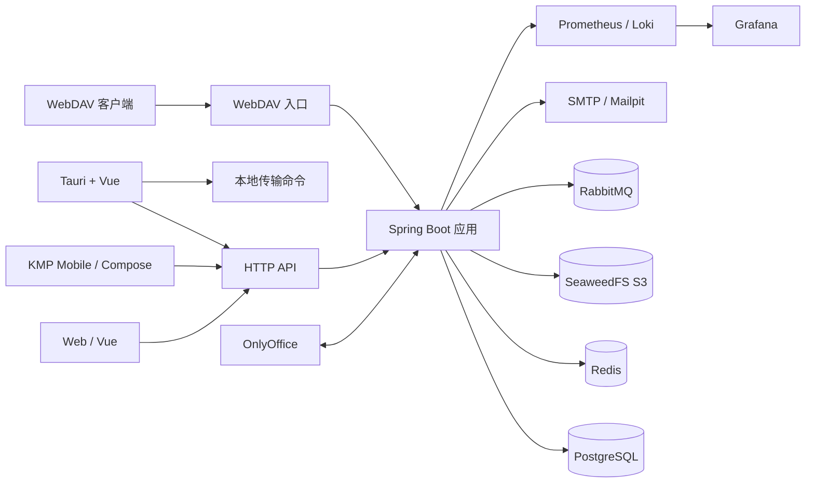

# 系统架构总览

本文面向需要理解 BetterCloudDrive 整体边界的开发者和评审者，说明运行组件、数据归属、同步与异步链路。具体接口和配置分别以 [API 参考](../reference/API.md) 与 [配置参考](../reference/CONFIGURATION.md) 为准。

## 系统定位

BetterCloudDrive 是一个同时提供个人空间和团队空间的云盘系统。用户通过 Web、Tauri 桌面端、KMP 移动端或 WebDAV 访问统一后端；后端负责身份认证、元数据与权限、对象传输、分享、版本、通知、后台任务和管理能力。

## 运行组件

| 组件 | 职责 | 是否保存权威业务状态 |
|------|------|----------------------|
| `frontend` | Nginx 托管 Vue 单页应用并代理后端请求 | 否 |
| `backend` | REST、WebDAV、认证、业务服务、定时任务和队列消费者 | 否；状态写入外部存储 |
| PostgreSQL | 用户、团队、文件元数据、权限、任务、审计、通知和 Outbox | 是 |
| SeaweedFS | 文件正文、缩略图、历史版本和部分任务产物 | 是，与 PostgreSQL 元数据共同构成可恢复状态 |
| Redis | 上传分片位图、访问计数、限流和其他短期状态 | 否；不能替代 PostgreSQL 或对象存储备份 |
| RabbitMQ | 通知、团队任务等异步工作的可靠投递与唤醒 | 否；持久事实先落 PostgreSQL |
| OnlyOffice | 在线预览和编辑文档 | 否；保存结果最终进入文件版本与对象存储 |
| Mailpit / SMTP | 开发环境邮件接收或生产邮件投递 | 否 |
| Prometheus、Loki、Alloy、Grafana、Alertmanager | 指标、日志、仪表盘和告警 | 只保存观测数据，不作为业务恢复来源 |

Compose 中的具体镜像、端口、卷和生产覆盖规则参阅[配置参考](../reference/CONFIGURATION.md)。

## 请求与数据边界

典型同步请求依次经过安全过滤器、Controller、Service、Repository 或对象存储适配器。Controller 负责 HTTP 协议和当前用户解析，业务约束与事务放在 Service，DAL 只负责实体和查询，Storage 模块只封装 S3 兼容对象操作。

业务数据分成两类：

- PostgreSQL 保存“对象是什么、属于谁、当前状态如何”，例如 `files`、`teams`、`team_file_permissions` 和 `team_tasks`。
- SeaweedFS 保存“对象内容是什么”，数据库中的 `storage_path`、`thumbnail_path` 和版本路径指向对应对象。

因此只恢复其中一侧会产生悬空元数据或孤立对象。选择原因见[元数据与对象内容分离 ADR](../decisions/004-metadata-object-storage.md)；备份和恢复必须以同一时间点协调 PostgreSQL 与 SeaweedFS，详见[备份与恢复](../operations/BACKUP_RESTORE.md)。

## 同步与异步边界

需要立即给出业务结果的操作在请求事务内完成，例如鉴权、权限判断、创建文件元数据和修改团队成员。较慢或需要重试的工作通过以下持久状态承接：

1. 业务事务写入 PostgreSQL 的 Outbox 或 `team_tasks`。
2. 调度器发布 RabbitMQ 消息，或按任务类型领取待处理记录。
3. 消费者/Worker 执行通知、压缩、审计导出、缩略图或 OnlyOffice 保存。
4. 执行结果回写 PostgreSQL；失败进入可重试任务状态或死信记录。

RabbitMQ 是投递通道，不是任务事实来源。相关设计原因参阅[RabbitMQ 投递 ADR](../decisions/002-message-queue-selection.md)，执行链路参阅[异步任务流](flows/ASYNC_TASKS.md)。

## 部署形态

- 本地开发可只启动基础设施，再分别运行后端、Web、Tauri 或 KMP 移动端。
- 默认 Compose 启动完整应用、基础设施和观测栈，便于集成验证。
- 生产覆盖文件收紧基础设施端口暴露，并调整前后端入口；它不会改变模块边界或业务数据归属。

当前后端是模块化单体：七个 Maven 模块最终组装为一个 Spring Boot 进程，而不是七个独立服务。选择原因见[模块化单体 ADR](../decisions/003-modular-monolith.md)，模块依赖见[后端架构](BACKEND.md)。

## 主要失败边界

| 故障 | 直接影响 | 恢复入口 |
|------|----------|----------|
| PostgreSQL 不可用 | 认证后业务操作和任务状态不可用 | 数据库健康、连接池、备份恢复 |
| SeaweedFS 不可用 | 上传、下载、预览和版本保存失败 | 对象存储健康、容量和对象路径 |
| Redis 不可用 | 限流、上传进度或临时计数受影响 | Redis 健康与短期状态重建 |
| RabbitMQ 不可用 | 异步投递延迟；已落库事实仍保留 | Outbox 积压、队列和死信监控 |
| OnlyOffice 不可用 | 在线编辑/预览不可用，普通文件能力仍可使用 | [OnlyOffice 排障](../operations/ONLYOFFICE_DEPLOYMENT.md) |
| 观测栈不可用 | 日志查询、指标和告警受影响，不应阻断核心业务 | [观测与排障](../operations/OBSERVABILITY.md) |

## 继续阅读

- [后端架构](BACKEND.md)
- [数据模型](DATA_MODEL.md)
- [客户端架构](CLIENTS.md)
- [权限模型](PERMISSIONS.md)
- [上传与下载流](flows/UPLOAD_DOWNLOAD.md)
- [异步任务流](flows/ASYNC_TASKS.md)
- [OnlyOffice 保存流](flows/ONLYOFFICE_SAVE.md)
