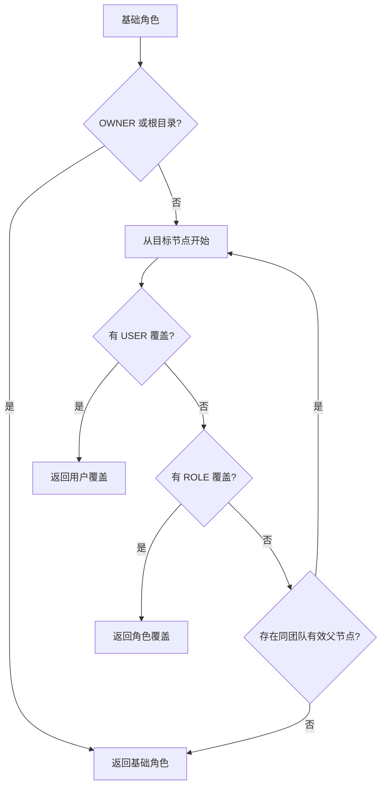

# 权限模型

本文面向后端和客户端开发者，解释全局角色、团队角色与团队文件细粒度权限的组合规则。优先级的选择原因见[团队文件权限 ADR](../decisions/005-team-file-permissions.md)；接口形式见 [API 参考](../reference/API.md)，本文以 `TeamService` 和 `TeamPermissionServiceImpl` 的当前实现为事实来源。

## 三个权限层次

| 层次 | 数据来源 | 作用域 | 示例 |
|------|----------|--------|------|
| 账号状态与全局角色 | `users.status`、`users.role` | 整个系统 | `ROLE_USER`、`ROLE_ADMIN` |
| 团队成员角色 | `team_members.role/status` | 一个团队 | `OWNER`、`ADMIN`、`EDITOR`、`VIEWER` |
| 文件权限覆盖 | `team_file_permissions` | 一个团队内的文件/目录子树 | 对用户或角色覆盖五项能力 |

全局管理员不等同于团队 OWNER；普通团队接口仍按团队成员与文件权限执行。管理员专用接口可以具有独立的系统管理授权。

## 团队基础角色

| 角色 | 读 | 写 | 分享 | 删除 | 管理权限 |
|------|----|----|------|------|----------|
| `OWNER` | 是 | 是 | 是 | 是 | 是 |
| `ADMIN` | 是 | 是 | 是 | 是 | 是 |
| `EDITOR` | 是 | 是 | 是 | 是 | 否 |
| `VIEWER` | 是 | 否 | 否 | 否 | 否 |

OWNER 的文件权限不可被覆盖。团队根目录没有 `fileId`，直接采用基础角色；在根目录创建内容要求团队级写权限。

团队管理还有额外的角色规则：只有 OWNER 可以转移所有权或执行 owner-only 操作；OWNER/ADMIN 可以管理一般成员，ADMIN 不能授予或管理与 OWNER 同级的能力。具体端点以 API 参考为准。

## 覆盖记录

覆盖 subject 有两种：

- `USER`：针对一个具体团队成员，`subject_user_id` 必填。
- `ROLE`：针对 `ADMIN`、`EDITOR` 或 `VIEWER`，`subject_role` 必填。

每条记录完整给出 `canRead`、`canWrite`、`canShare`、`canDelete`、`canManage`，不是只修改其中一位。若 `canRead=false`，其余四项必须同时为 false。

## 解析顺序

对指定用户和文件，服务端按以下顺序求有效权限：

1. 验证用户是状态有效的团队成员，并取得基础角色权限。
2. OWNER 或团队根目录直接返回基础角色。
3. 从目标文件开始向父目录逐级查找。
4. 在同一节点先找该用户的 `USER` 覆盖。
5. 没有用户覆盖时，再找该成员角色的 `ROLE` 覆盖。
6. 找到第一条匹配后立即停止；否则继续父节点。
7. 一直没有匹配时返回基础角色。

这意味着“最近节点优先”高于“用户始终优先”：目标节点的角色覆盖会先于父目录的用户覆盖命中；只有在同一个节点，用户覆盖才优先于角色覆盖。

## 继承与资源可见性

目录覆盖会被后代继承，直到更近的文件/目录出现匹配覆盖。有效权限响应包含：

- `sourceType`：`BASE_ROLE`、`USER_OVERRIDE` 或 `ROLE_OVERRIDE`。
- `sourceChain`：基础角色以及最终命中的覆盖来源。
- `inherited`：命中的覆盖是否来自父节点。

`canRead=false` 的资源不应在普通列表或搜索中暴露；客户端也应隐藏入口，但真正的数据隔离必须由服务端查询/逐项过滤和下载前校验实现。移动资源后，新的父链可能改变继承结果，因此不能缓存永久有效权限。

## 操作到能力的映射

| 操作类型 | 至少需要 |
|----------|----------|
| 查看、列表、预览、下载、版本读取 | `canRead` |
| 在目录中新建文件夹、上传 | 父目录 `canWrite`；根目录使用团队写权限 |
| 重命名或修改内容 | 目标资源 `canWrite` |
| 移动 | 源资源写权限及目标父目录写权限；具体组合以 Service 为准 |
| 创建/修改分享 | `canShare` |
| 移入回收站或永久删除 | `canDelete` |
| 查看、创建、删除权限覆盖 | `canManage` |

涉及多个资源的操作必须分别校验源和目标，不能用一个目录的权限推断另一个目录。

## 防止自锁与越权

当前写入规则包含以下保护：

- OWNER 不能成为用户覆盖对象。
- 操作者不能通过用户覆盖移除自己的 `canManage`。
- 操作者不能通过自身角色覆盖移除自己的 `canManage`。
- 角色覆盖不能以 `OWNER` 为 subject。
- 覆盖的团队、文件、用户必须属于同一有效团队作用域。

修改或删除覆盖会写团队审计，并向受影响用户或角色成员发送通知。

## 客户端约定

客户端应使用服务端返回的有效权限控制动作状态，并展示权限来源，特别是“当前节点覆盖”和“继承覆盖”的区别。收到 403 时应重新加载团队成员和有效权限，处理角色变化、覆盖变化或团队被归档/删除的情况。

客户端不得自行复制继承算法作为授权依据。即使为了即时 UI 反馈做本地计算，提交请求前后都必须接受服务端结果。

## 变更检查

修改角色或权限算法时至少同步检查：

- `TeamService`、`TeamPermissionServiceImpl` 与数据库约束。
- 团队文件列表、搜索、预览、下载、上传、移动、分享、回收站和版本端点。
- Web、Tauri 和 Android 的按钮、菜单、路由守卫与错误处理。
- 用户覆盖优先级、父目录继承、移动后重算、自锁保护和 OWNER 不可覆盖测试。
- [API 参考](../reference/API.md)中的角色、有效权限和覆盖 DTO。
