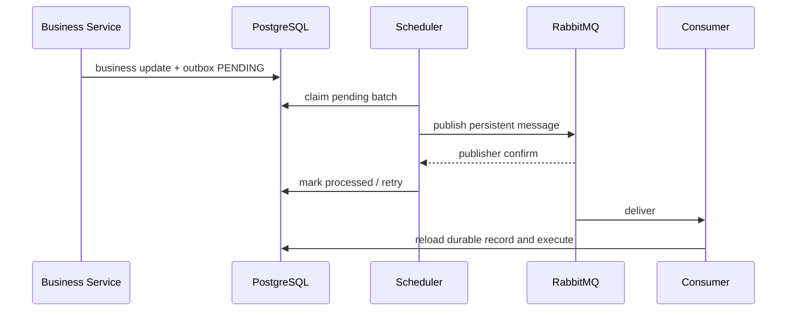

# 异步任务链路

本文说明 PostgreSQL Outbox、`team_tasks`、RabbitMQ、调度器与死信记录之间的职责。消息拓扑的选型背景见[RabbitMQ 投递 ADR](../../decisions/002-message-queue-selection.md)。

## 核心原则

PostgreSQL 是异步工作的事实来源，RabbitMQ 是可靠投递和唤醒通道。创建业务状态与待处理记录应处于同一数据库事务；消费者收到消息后根据记录 ID 重新读取状态，消息正文不能成为唯一事实。

## Outbox 发布

`TeamEventOutboxPublishTask` 周期领取待发布记录，发布批次和间隔由配置控制。发布使用持久消息、message ID、W3C trace headers 和 publisher confirm；只有 broker 确认且消息没有被退回后，才视为成功投递。

## 团队任务

`team_tasks` 为用户可见的长任务状态中心，当前承载审计导出、文件夹压缩、缩略图和 OnlyOffice 保存等工作。记录包含：

- 任务类型、团队、操作者与目标。
- 状态、进度、重试次数和可本地化消息 key。
- trace context，用于请求与延迟执行之间的关联。
- 可下载结果的路径、文件名、类型、大小和过期时间。

Worker 通过领取待处理记录获得执行权，更新 started/completed 时间和最终状态。重试接口应复用既有任务语义或明确创建新的尝试，不得让一个成功任务再次产生重复副作用。

## 通知

通知投递通过 Outbox/RabbitMQ 解耦业务事务和邮件/实时推送。持久通知记录包含语言无关的消息 key 与参数；消费者依据用户偏好生成站内通知和邮件，并由实时发布器把新事件送到已连接的 SSE 会话。

SSE ticket 是短期连接凭据，不属于队列状态。RabbitMQ 故障时，已写入数据库的事件可以稍后发布，不应丢失业务事务。

## 重试与死信

消费者失败时按队列投递策略重试。超过最大投递次数或消息不可处理后进入死信队列，`DeadLetterQueueConsumer` 将其登记到 `dead_letter_records`。

死信记录保存来源队列、路由键、失败分类、投递次数、trace、状态和处理人；原始 payload 不通过管理 API 暴露。管理动作包括带幂等 replay token 的重放或说明原因的丢弃。重放成功后仍需观察目标任务/通知是否产生预期状态。

## 可观测性

至少监控：Outbox 待处理数量与最老事件年龄、RabbitMQ 队列深度、消费失败、死信 OPEN 数量、任务处理耗时和任务失败率。请求的 `traceparent`/`tracestate` 被持久化并在 Worker 中建立 linked trace。

排障顺序：

1. 查 PostgreSQL 持久记录，确定事实是否已经创建。
2. 查 Outbox/任务状态和最后错误。
3. 查 RabbitMQ 队列与消费者健康。
4. 通过 request ID/trace ID 关联应用日志。
5. 查死信记录，决定重放、丢弃或修复数据后再重试。

具体指标和查询入口见[观测与排障](../../operations/OBSERVABILITY.md)。

## 变更检查

新增异步任务时必须明确：持久事实表、幂等键、领取并发、成功条件、超时、最大重试、死信分类、用户可见状态、结果清理、trace 传播和对应 Runbook。
