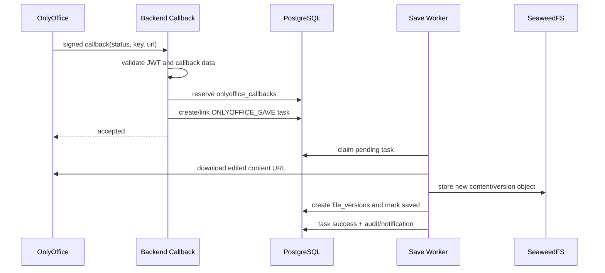

# OnlyOffice 保存链路

本文描述团队文档编辑结果从 OnlyOffice 回调进入 BetterCloudDrive 版本系统的过程。异步持久任务的选择原因见[OnlyOffice 保存 ADR](../../decisions/007-onlyoffice-async-save.md)，部署地址、JWT 和故障命令见 [OnlyOffice 部署与排障](../../operations/ONLYOFFICE_DEPLOYMENT.md)。

## 打开编辑器

客户端请求团队文件的 OnlyOffice 配置。Web/Qt 默认按文件有效权限取得查看或编辑配置；移动端携带 `mobile=true`，后端强制生成 `type=mobile`、`mode=view` 的只读配置，不签发 callback token。只有可编辑的桌面配置包含回调 URL。客户端只负责加载后端完成签名的配置，不能自行构造可信回调、修改平台类型或扩大权限。

## 异步保存

回调请求不在 HTTP 线程中下载大文件并完成所有保存。后端先验证回调 JWT 和状态，使用回调复合键预留保存记录，再创建可观察、可重试的 `ONLYOFFICE_SAVE` 团队任务。

Worker 领取任务后从回调 URL 下载编辑结果，调用统一版本服务写入对象存储和 `file_versions`，然后更新当前文件信息、回调状态和任务结果。

## 幂等

`onlyoffice_callbacks` 对以下组合设置唯一约束：团队、文件、callback key、回调状态和内容 URL 的 SHA-256。相同回调重复投递只能取得同一保存预留，不能创建重复版本；同一文档稍后产生的新内容 URL 仍可形成新的合法保存。

过长 callback key 会被哈希为稳定键。回调记录关联最终 `version_id` 和 `task_id`，用于区分 pending、saved 与 failed，并支持从任务中心重试失败保存。

## 失败与恢复

下载、对象写入或版本保存失败时，系统：

- 把回调和团队任务标记为失败，并保存受限长度的错误信息。
- 记录 `OFFICE_SAVE_FAILED` 团队审计。
- 通知打开编辑会话的用户，从团队任务中心重试。
- 增加 OnlyOffice 保存失败指标并保留 trace 关联。

重试前应先确认回调下载 URL 仍有效、OnlyOffice 能访问后端内部 URL、JWT 密钥一致、目标文件仍属于原团队且对象存储可写。不要通过手工修改 `file_versions` 绕过版本服务。

## 一致性边界

OnlyOffice 自身卷不是文档历史版本的权威存储。保存成功后的内容对象位于 SeaweedFS，版本元数据位于 PostgreSQL；两者必须协调备份。回调状态只能说明 BetterCloudDrive 的处理结果，不能替代对象存在性和版本记录验证。

## 修改检查

修改该链路时至少验证：回调 JWT、重复投递、同 key 不同内容、权限、下载超时、Worker 重试、版本递增、审计/通知、对象存储失败、任务中心状态以及 PostgreSQL/SeaweedFS 恢复一致性。
