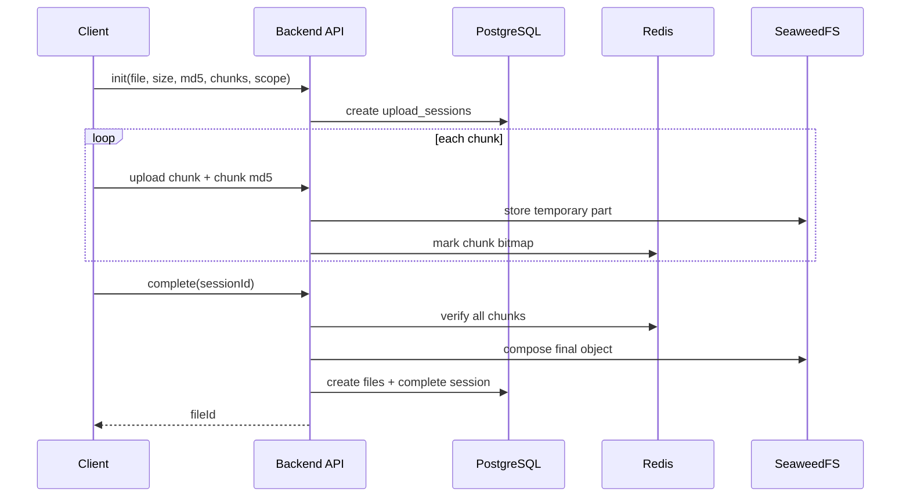

# 上传与下载链路

本文说明个人/团队文件内容如何在客户端、后端、PostgreSQL、Redis 和 SeaweedFS 之间流动。具体请求参数与路径以 [API 参考](../../reference/API.md)为准。

## 分片上传



个人和团队上传使用相同状态机，但团队上传还要校验成员身份、目标父目录写权限和团队配额。`parentId=NULL` 表示根目录；非空父节点必须是同一作用域内未删除的目录。

初始化只创建会话，不代表文件已经可见。每个分片先校验编号与摘要，再写临时对象并更新 Redis 位图。完成操作确认全部分片后组合最终对象、创建文件元数据并记录 `completed_file_id`。

## 幂等与失败处理

- 同一个已完成会话再次 complete，返回原 `completed_file_id`，不重复创建文件或累计配额。
- 分片重复提交会根据位图和会话状态处理，不应重复累计 received count。
- 对象组合成功但数据库提交失败属于跨存储不一致风险，后续清理必须能识别未被元数据引用的对象。
- 取消或过期会话删除临时分片；过期上传任务负责兜底清理。
- MD5 instant upload 可以复用已有对象路径，但仍会创建独立文件元数据；删除一个逻辑文件时不能误删仍被其他记录引用的对象。

## 流式上传

WebDAV 等入口可以使用服务端流式上传。后端按固定大小读取输入、计算摘要并写临时分片，完成后组合对象和创建个人文件记录。该入口仍需执行目标目录、配额和文件名约束，不能绕过普通业务服务。

## 下载

下载前，后端先解析当前用户/分享访问上下文，再验证文件作用域、删除状态和权限。元数据校验通过后，后端从 `storage_path` 读取对象并返回内容。

```text
请求身份或一次性 ticket
  -> 解析个人 / 团队 / 分享作用域
  -> 校验资源与 canRead
  -> 读取 PostgreSQL 元数据
  -> 从 SeaweedFS 读取 storage_path
  -> 处理 Range / Content-Disposition
```

团队文件和文件夹下载可先创建短期下载 ticket，避免把长期 Bearer token 放进浏览器导航 URL。分享下载则按分享码、密码、有效期和访问次数单独授权。

## 文件夹压缩

文件夹下载可能转为后台任务或使用 `folder_zip_download_cache`：系统根据内容签名复用仍有效的压缩对象，结果文件存入对象存储或任务结果目录，并由清理任务按最后下载时间/有效期回收。生成压缩包前必须对目录树内资源执行访问校验。

## 修改检查

调整上传下载链路时同步检查：API、Web/Tauri/KMP 移动端、会话幂等、个人/团队作用域、配额、Range 下载、临时对象清理、备份恢复和传输相关指标。
